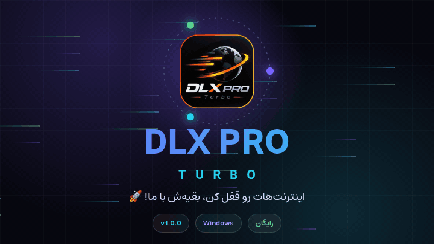
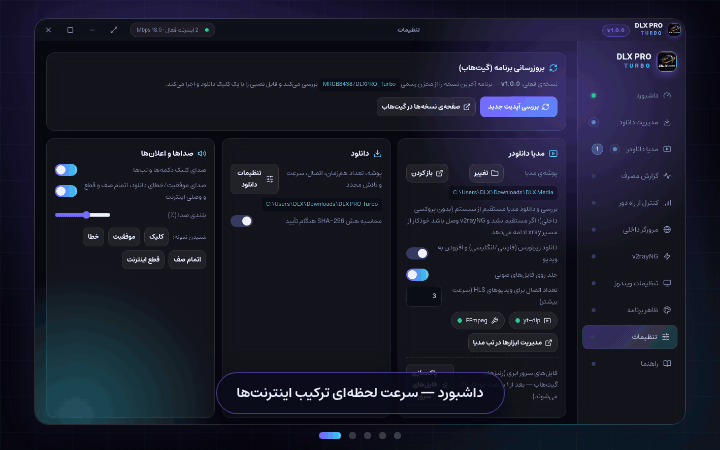
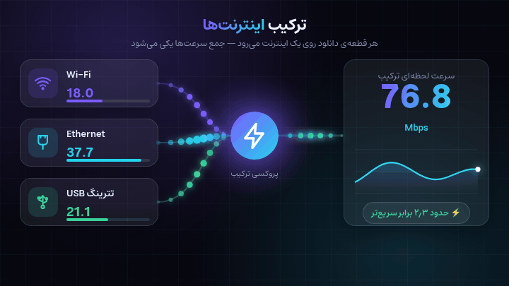
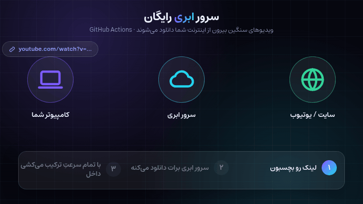

[README.md](https://github.com/user-attachments/files/34011753/README.md)

  

  
  
  
  
  

  <a href="#install">نصب</a> ·
  <a href="#features">قابلیت‌ها</a> ·
  <a href="#faq">سوال‌های پرتکرار</a> ·
  <a href="#english">English</a> ·
  <a href="https://github.com/MRGB8438/DLXPRO_Turbo/releases">دانلود</a>

## ⚡ DLX PRO Turbo چیه؟

یک برنامه‌ی ویندوزی که **همه‌ی اینترنت‌هات رو هم‌زمان** به کار می‌گیره — وای‌فای، کابل شبکه (Ethernet)، مودم و تترینگ USB — و دانلودهات رو با **مجموع سرعت همه‌شون** می‌کشه.
به‌جای اینکه فقط یکی از اینترنت‌ها کار کنه و بقیه بیکار بمونن، هر قطعه از فایل روی یک اینترنت می‌ره. 🌪️

> **اینترنت‌هات رو قفل کن، بقیه‌ش با ما!** 🚀

   
  یک نگاه سریع به برنامه: داشبورد، مدیریت دانلود، مدیا دانلودر، گزارش مصرف و تنظیمات

---

## 🌪️ ترکیب اینترنت‌ها

کارت‌های شبکه رو روشن/خاموش کن؛ «پروکسی ترکیب» برنامه، دانلودها و مرورگر داخلی رو بین همه‌ی کارت‌های روشن پخش می‌کنه. سه حالت پخش داری:

| حالت | کار می‌کنه چطوری؟ |
|---|---|
| ⚖️ **متعادل** | ترافیک بر اساس وزن (سرعت) هر اینترنت تقسیم می‌شه |
| 🚀 **سریع‌ترین پینگ** | هر درخواست به اینترنتی می‌ره که همین الان کم‌پینگ‌تره |
| 🛡️ **اصلی + پشتیبان** | یک اینترنت اصلی؛ اگه افتاد، پشتیبان جایگزین می‌شه |

  

## 🧲 دانلود چندبخشی

هر فایل به چند قطعه (تا ۳۲ قسمت هم‌زمان) تقسیم می‌شه و هر قطعه روی یک اینترنت می‌ره. دانلود نصفه‌کاره هم ادامه پیدا می‌کنه.

  

## ☁️ سرور ابری رایگان

برای ویدیوهای سنگین (یوتیوب و…) دو راه داری: **دانلود مستقیم** یا **سرور ابری**. در حالت سرور ابری، ویدیو *بیرون از اینترنت خودت* (روی GitHub Actions) دانلود می‌شه و بعد با **تمام سرعتِ ترکیب** به سیستمت می‌آد.

- محدودیت: تا ۴ گیگابایت و ۱۸۰ دقیقه برای هر ویدیو
- فایل‌های روی سرور بعد از ۱ ساعت خودکار پاک می‌شن
- لازم نیست توکن یا ریپو تنظیم کنی

  

---

## ✨ قابلیت‌ها

| | قابلیت | توضیح |
|---|---|---|
| 🌪️ | **ترکیب اینترنت‌ها** | وای‌فای + Ethernet + USB با هم، سه حالت پخش ترافیک |
| 🧲 | **مدیریت دانلود** | صف با پوشه‌ی اختصاصی، زمان‌بندی، ادامه‌ی دانلود، خاموشی خودکار بعد از پایان |
| 🎬 | **مدیا دانلودر** | یوتیوب، اینستاگرام، تیک‌توک و ۱۰۰۰+ سایت؛ انتخاب کیفیت، زیرنویس و کاور (yt-dlp داخل برنامه است) |
| ☁️ | **سرور ابری** | دانلود روی سرور رایگان، بعد کشیدن با سرعت ترکیب |
| 🧩 | **افزونه‌ی مرورگر** | Chrome / Edge / Firefox + پنجره‌ی «دانلود همه‌ی لینک‌ها» |
| 🌐 | **مرورگر داخلی** | از پروکسی ترکیب استفاده می‌کنه |
| ⚡ | **v2rayNG** | لینک ساب یا تکی (vmess / vless / trojan / ss) با هسته‌ی xray داخل برنامه |
| 📶 | **هات‌اسپات** | اینترنت ترکیب‌شده رو با موبایل و لپ‌تاپ به اشتراک بذار |
| 📱 | **کنترل از راه دور** | برنامه رو از گوشی (روی همان شبکه) کنترل کن؛ QR یا رمز ثابت |
| 📊 | **گزارش مصرف** | نمودار و جزئیات مصرف روزانه، خروجی PDF |
| 🖥️ | **تنظیمات ویندوز** | پروکسی ویندوز، Metric، DNS و بهینه‌سازی TCP |
| 🎨 | **ظاهر شیشه‌ای** | تم‌های زنده، تقویم شمسی، فونت استعداد |
| 🔄 | **آپدیت خودکار** | از همین ریپو چک، دانلود و نصب می‌کنه |

---

## 📥 نصب — ۳۰ ثانیه‌ای

1. برو به بخش [**Releases**](https://github.com/MRGB8438/DLXPRO_Turbo/releases)
2. آخرین `DLX-PRO-Turbo-Setup-1.0.0.exe` رو دانلود کن
3. اجرا کن → **Run as administrator** (برای قابلیت‌های شبکه، دسترسی ادمین لازمه)
4. تمام! ابزارها (yt-dlp و FFmpeg) دفعه‌ی اول خودکار نصب می‌شن

> 💡 بعد از نصب، **افزونه‌ی مرورگر** رو هم وصل کن (تنظیمات ← افزونه‌ی مرورگر). از اون به بعد دانلودهای مرورگر مستقیم می‌رن توی DLX.

### 🧩 نصب افزونه‌ی مرورگر

| مرورگر | روش |
|---|---|
| Chrome / Edge | `chrome://extensions` ← Developer mode ← **Load unpacked** ← پوشه‌ی `chrome` |
| Firefox | `about:debugging` ← This Firefox ← **Load Temporary Add-on** ← فایل `manifest.json` پوشه‌ی `firefox` |

بعد از نصب، وقتی برنامه روشنه یه بار دکمه‌ی افزونه رو بزن تا درخواست اتصال داخل برنامه تأیید بشه. ✅

### 🔄 آپدیت خودکار

**تنظیمات ← بروزرسانی برنامه** ← «بررسی آپدیت جدید» ← «دانلود آپدیت» (با نوار پیشرفت) ← «نصب و راه‌اندازی مجدد». برنامه موقع اجرا هم بی‌صدا چک می‌کنه و اگه نسخه‌ی جدید بود خبر می‌ده. 🔔

## ❓ سوال‌های پرتکرار

**مگه واقعاً سرعت رو جمع می‌کنه؟**
برای فایل‌هایی که سرور از دانلود چندبخشی پشتیبانی می‌کنه، بله: هر قطعه روی یک اینترنت می‌ره و سرعت‌ها جمع می‌شن. اگه سایت فقط یک اتصال بده یا خودش سرعت هر کاربر رو محدود کنه، نتیجه کمتر خواهد بود.

**چرا ادمین می‌خواد؟**
تنظیم پروکسی ویندوز، Metric و DNS به دسترسی ادمین نیاز دارن. بدون ادمین هم دانلود و مدیا کار می‌کنه ولی بخش «تنظیمات ویندوز» محدود می‌شه.

**آنتی‌ویروس هشدار داد؟**
نصاب امضای دیجیتال نداره؛ در پنجره‌ی SmartScreen روی «More info ← Run anyway» بزن.

**ویندوز بعد از بستن ناگهانی برنامه اینترنت نداره!**
برنامه‌ی DLX رو یک بار باز کن تا پروکسی ویندوز رو به حالت قبل برگردونه، یا از تنظیمات ویندوز پروکسی رو دستی خاموش کن.

**«سرور ابری» و «دانلود مستقیم» فرقشون چیه؟**
مستقیم: همون لحظه و با ترکیب اینترنت‌های خودت. سرور ابری: ویدیو بیرون از اینترنت تو دانلود می‌شه و بعد با تمام سرعت می‌آد؛ برای ویدیوهای سنگین یا سایت‌هایی که مستقیم کند هستن.

## 🛠️ اجرا از سورس

1. [Node.js](https://nodejs.org) (نسخه‌ی LTS) نصب کن.
2. `run.bat` رو (ترجیحاً با Run as administrator) اجرا کن.
3. برای ساخت نصاب: `build.bat` ← خروجی در پوشه‌ی `dist`.

راهنمای کامل‌تر: [`README-FA.txt`](README-FA.txt) · تغییرات: [`CHANGELOG-fa.md`](CHANGELOG-fa.md)

## 🤝 مشارکت و گزارش باگ

پیشنهاد یا باگ داری؟ یه [Issue](https://github.com/MRGB8438/DLXPRO_Turbo/issues) باز کن. اگه باگ دیدی، از تب تنظیمات «کپی آخرین خطا» رو بزن و همون‌جا بفرست — کار ما خیلی راحت‌تر می‌شه! 🙏

---

## 🇬🇧 English

**DLX PRO Turbo** is a Windows app that bonds all your internet connections (Wi-Fi + Ethernet + modem + USB tethering) and uses them at once for your downloads.

- 🌪️ **Internet bonding** — a local proxy spreads traffic across every enabled adapter (balanced / lowest-ping / primary + backup)
- 🧲 **Download manager** — queues, scheduling, resume, multisegment downloads (up to 32 parallel parts)
- 🎬 **Media downloader** — YouTube, Instagram, TikTok and 1000+ sites (yt-dlp bundled)
- ☁️ **Free cloud server** — heavy videos are fetched outside your network (GitHub Actions), then pulled in at full bonded speed
- 🧩 **Browser extension** — Chrome / Edge / Firefox, with a "Download All Links" dialog
- ⚡ **v2rayNG, hotspot, remote control, usage reports, Windows network tweaks**
- 🔄 **Auto-update** straight from this repo

**Install:** grab the latest `DLX-PRO-Turbo-Setup-1.0.0.exe` from [Releases](https://github.com/MRGB8438/DLXPRO_Turbo/releases) and run it as administrator.

## 📜 License

Free for personal use. Made with ⚡ and ☕.

   

  <b>DLX PRO TURBO</b> — <i>Downloads on Turbo Juice 🚀</i> 
### 🤖 ساخته‌شده با هوش مصنوعی | AI-Powered

از ایده تا پیاده‌سازی نهایی، DLX PRO Turbo با کمک هوش مصنوعی توسعه داده شده است. 🤖🛠️

From idea to implementation, DLX PRO Turbo was built with the power of AI. 🚀

**ساخته‌شده با خلاقیت، قدرت‌گرفته از هوش مصنوعی.** ⚡
**Built with creativity, powered by AI.** ⚡  ⭐ اگه خوشت اومد یه Star بزن — انگیزه‌ی ما هم توربو می‌شه! ⭐

